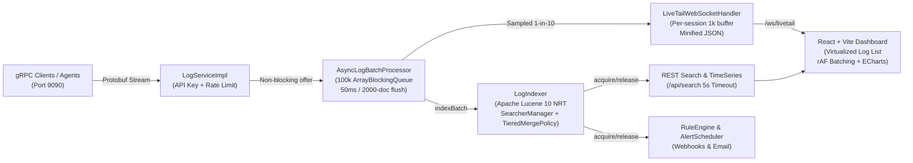

# 📜 Log Stream — High-Throughput Observability & Log Analytics Platform

A custom, production-ready observability and log analytics platform built from scratch using **Java 21**, **Spring Boot**, **gRPC**, **WebSockets**, **Apache Lucene 10**, and **React + Vite (Apache ECharts)**.

---

## 🏗️ System Architecture



---

## ✨ Key Features & Optimizations

- 🚀 **High-Throughput gRPC Ingestion:** Non-blocking `ArrayBlockingQueue` (100k capacity) decouples gRPC workers from disk I/O, flushing micro-batches of up to 2,000 documents every 50ms.
- 🔍 **Sub-50ms Lucene 10 NRT Search:** `SearcherManager` with Near Real-Time (NRT) soft refreshes (1,000ms), periodic hard commits (30s), `TieredMergePolicy` (512MB max segment), and a 5-second query timeout circuit-breaker (`HTTP 408`).
- 🧵 **Java 21 Virtual Threads & ZGC:** Enabled `spring.threads.virtual.enabled=true` with virtual-thread `@Async` / alert executors, bounded query pools, and Generational ZGC (`-XX:+UseZGC -XX:+ZGenerational`) in containers.
- ⚡ **Backpressure-Safe Live Tail:** Per-session 1,000-message bounded queues drop slow consumers safely, prioritize `ERROR`/`WARN` logs, and emit minified JSON (`{"t":...,"l":...,"s":...,"m":...}`).
- 🖥️ **60fps React + ECharts Frontend:** Custom `ResizeObserver` virtualized log list (`ITEM_HEIGHT=28`), `requestAnimationFrame` WebSocket batching, `React.memo` rows, and 1s ECharts render throttling.
- 🚨 **Smart Alerting & Webhooks:** Background rule evaluation with webhook/email dispatching and audit history.
- 🛡️ **Security & Access Control:** JWT authentication, RBAC, REST & gRPC rate limiting, API key validation, and Lucene query sanitization.

---

## 📊 Performance Benchmarks

| Metric | Target | Measured / Configured Capacity | Details |
| :--- | :--- | :--- | :--- |
| **gRPC Ingestion Buffer** | ≥ 10,000 logs/sec | 100,000-entry queue, 2,000-doc batches | `AsyncLogBatchProcessor` + `LogIngestionStressTest` |
| **Lucene Search Latency (p95)** | < 50 ms | Verified `< 50 ms` across term, level, service & combined queries | `SearchLatencyBenchmarkTest` (100k warm index) |
| **NRT Visibility Delay** | ≤ 1,000 ms | 1,000 ms soft refresh / 30s hard commit | `LuceneNrtSearcherManagerTest` |
| **WebSocket Backpressure** | Zero OOM on slow clients | 1,000 msg/session cap + 1-in-5 `INFO`/`DEBUG` sampling | `LiveTailWebSocketHandler` |
| **Search Circuit-Breaker** | Prevent thread starvation | 5,000 ms max query execution (`HTTP 408`) | `SearchTimeoutTest` |

See [docs/benchmarks.md](docs/benchmarks.md) for full methodology and [docs/operations-runbook.md](docs/operations-runbook.md) for production tuning.

---

## 💻 Tech Stack

- **Backend:** Java 21, Spring Boot 4.1.2, Virtual Threads
- **Ingestion & Streaming:** gRPC (Port `9090`), WebSockets (`/ws/livetail`), REST APIs (Port `8080`)
- **Search & Storage:** Apache Lucene 10.5.2 (`SearcherManager`, `TieredMergePolicy`)
- **Frontend:** React 18, Vite, Apache ECharts, Nginx (in Docker)
- **Containerization:** Multi-stage Dockerfiles + `docker-compose.yml`

---

## 🚀 Quickstart

### Option 1: Docker Compose (Recommended for Production / Testing)
```bash
docker compose up --build
```
- **Frontend Dashboard:** http://localhost:3000
- **Backend REST API:** http://localhost:8080
- **gRPC Ingestion Server:** `localhost:9090`

### Option 2: Local Development
1. **Start Backend (Java 21 + Maven):**
   ```bash
   mvn spring-boot:run
   ```
   *(Optional: pass `-Dspring-boot.run.arguments="--logstream.seed=true"` to seed 1M logs on startup.)*

2. **Start Frontend (Node 20+):**
   ```bash
   cd frontend
   npm install
   npm run dev
   ```
   Open http://localhost:3000.

3. **Run Tests & Benchmarks:**
   ```bash
   mvn test
   ```

---

## 📡 API Reference

| Protocol | Endpoint / Method | Description |
| :--- | :--- | :--- |
| **gRPC** | `LogService/StreamLogs` (`:9090`) | High-throughput client-streaming log ingestion (requires `x-api-key` metadata) |
| **WebSocket** | `ws://host:8080/ws/livetail` | Real-time minified JSON log stream (JWT token supported) |
| **REST** | `GET /api/search?q=&level=&service=&limit=&sinceMinutes=` | Lucene log search with 5s circuit-breaker |
| **REST** | `GET /api/logs/timeseries` | Aggregated log volume buckets for ECharts |
| **REST** | `POST /api/auth/login` | Authenticate and obtain JWT bearer token |
| **REST** | `GET / POST /api/alerts/rules` | List or create alert rules |
| **REST** | `POST /api/alerts/evaluate` | Trigger immediate evaluation of alert rules |
| **REST** | `GET /api/alerts/history` | Audit history of dispatched webhooks/emails |

---

## 🧑‍🤝‍🧑 Team Members & Roles
- 🧑‍💻 **@SagarJadhav025:** Java gRPC Server, Data Ingestion & Performance Optimization
- ⚙️ **@kaustubh-ingle:** Apache Lucene Integration & Indexing
- 🗂️ **@Mehrajfathima-782:** Java Alerting Engine & Webhooks
- 🖥️ **@mirfan-dev:** React Dashboard & ECharts Setup
- 🔍 **@sakshikakade788-alt:** Search Logic & WebSocket Live Tail
